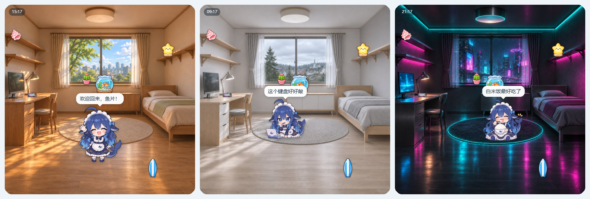

# 礼物小屋 gift-room

给你的 AI 伙伴一间小屋。屋里住着 Q 版的女仆鲸鱼娘，你送她的礼物会被画成图标摆进屋里；她白天坐在地毯上敲电脑、捧着碗吃白米饭，深夜在床上睡觉。

房间有三种装修风格可以切换：暖阳原木、北欧清晨、赛博夜。家具位置都一样，换风格不会打乱已经摆好的东西。



- **送礼**：从愿望单里挑一件，或者自己写一件。可以只送进小屋，也可以标成“真买了”，等快递到了再拍张实物照片。
- **画出来**：每件礼物都会生成一个图标；有实物照片的话照着照片画。生图接口自己配，也可以不配，手动传图标。
- **摆进屋里**：你的 AI 收到事件后自己决定摆在哪（窗台、矮柜、搁板、书桌、地上……）、起什么名字、收到时心里怎么想。它没处理的话，系统会自动找个空位摆上。
- **角色活动**：有一套自动作息，也可以由你的 AI 通过接口让她说话、换姿势。

这个项目只是一间屋子，不带任何聊天模型，也没有账号系统。要让屋里的角色“活”起来，需要你把自己的 AI 接进来。

| 文档 | 内容 |
|---|---|
| [使用说明](docs/guide.md) | 一步步装好、页面上每个按钮怎么用、手机上怎么看、常见问题 |
| [接入你自己的 AI](docs/connect-ai.md) | 收礼自动反应、命令行聊天、接进已有的聊天机器人（含 Windows 命令和工具定义） |
| [接口说明](docs/API.md) | 全部 HTTP 接口、webhook 事件格式、生图配置 |

## 快速开始

需要 Node.js 18.17 或更高版本，没有任何依赖。

```bash
git clone https://github.com/moASPILyu/feiyu_room.git
cd feiyu_room
npm start
```

第一次启动时会生成一个口令，保存在 `data/token.txt`。浏览器打开 `http://127.0.0.1:17800/#key=<口令>`，页面会记住口令，并把它从地址栏里去掉。

没用过命令行也没关系，[使用说明](docs/guide.md) 里有一步步的做法，也写了怎么在手机上看。不建议直接把端口开放到公网。

## 配置

复制 `config.example.json` 为 `config.json`，只填需要改的项就行：

```jsonc
{
  "port": 17800,
  "character": { "name": "鲸鱼娘", "sleep": [23, 7] },   // 名字会出现在页面上；sleep 是睡觉时段（本地小时）
  "theme": "warm",                                      // 默认风格：warm / nordic / cyber，看的人可以在页面上自己换
  "utcOffset": 8,                                       // 时区，北京时间是 8
  "autoPlaceMinutes": 10,                               // 收礼后多少分钟没人摆就自动摆；-1 表示不自动摆
  "image": { "provider": "openai", "openai": { "baseUrl": "https://api.openai.com/v1", "model": "gpt-image-1" } },
  "webhook": { "url": "http://127.0.0.1:17801/hook", "secret": "随便写一串" }
}
```

生图的 API key 不写进配置文件，而是放在环境变量里，变量名默认是 `GIFT_ROOM_IMAGE_KEY`。

### 生图的三种方式

| `image.provider` | 说明 |
|---|---|
| `none`（默认） | 不生成图标，屋里显示礼物盒和名字，可以在页面上手动传图标 |
| `openai` | 任何 OpenAI 兼容的图片接口（`/images/generations`），改 `baseUrl` 和 `model` 就能接到别家 |
| `command` | 运行你自己的命令（ComfyUI 脚本、本地模型都行），命令把图写到 `{out}` 即可 |

`command` 的例子：

```json
"image": { "provider": "command", "command": { "args": ["python", "my_draw.py", "--prompt", "{prompt}", "--out", "{out}", "--ref", "{ref}"] } }
```

## 接入你自己的 AI

小屋通过 webhook 告诉你的 AI“收到礼物了”，你的 AI 再调接口决定怎么摆、说什么。`examples/` 里有三个能直接跑的例子：

| 文件 | 用途 |
|---|---|
| `ai-bridge.mjs` | 收到礼物时自动起名、选位置、写心里话、说谢谢 |
| `chat-with-tools.mjs` | 在命令行里和她聊天，她能看屋子、记愿望单、摆东西 |
| `tools.json` + `room-tools.mjs` | 现成的工具定义，接进你已有的聊天机器人 |

聊天模型用任何 OpenAI 兼容的接口都行（DeepSeek、通义、Kimi、Ollama……）。分步教程见 [接入你自己的 AI](docs/connect-ai.md)，Windows 和 macOS/Linux 的命令都有。

## 换角色、加风格、改布局

- **角色**：替换 `public/character/` 下的 7 张透明 PNG 就行：`idle`（站着）、`think`（坐着敲电脑）、`play`（吃饭）、`wave`（挥手）、`gift`（抱礼物）、`sleep`（睡觉），外加礼物盒 `box`。再改一下 `character.name`。
- **加一种风格**：在 `public/themes/` 下新建一个文件夹，放一张正方形的 `bg.jpg` 和一个 `theme.json`（`{"name": "名字", "order": 4, "tint": "room"}`）。新背景的家具位置要和现有的一样，最简单的做法是拿 `themes/warm/bg.jpg` 当参考图，让生图模型“保持构图和家具位置不变，只换装修风格”。背景本身是夜景的，`tint` 写 `"none"`，页面就不再按时间调光线。
- **改布局**：`public/room.json` 定义了摆东西的位置、角色站在哪、礼物盒放哪、各时段的姿势。坐标都按背景图宽高的百分比写，字段说明在 `server/scenes.mjs` 开头。换了家具位置不同的背景，就要重新量这些坐标。

## 数据

所有数据都存在 `data/` 目录里：

| 文件 | 内容 |
|---|---|
| `items.json` | 礼物 |
| `wants.json` | 愿望单 |
| `character.json` | 外部设置的角色状态 |
| `log.jsonl` | 流水记录 |
| `icons/` | 图标 |
| `photos/` | 实物照片 |

备份时复制整个 `data/` 目录即可。

## 开发

```bash
npm test
```

## 许可

- **代码**：MIT，见 [LICENSE](LICENSE)。
- **美术素材**（`public/character/` 的鲸鱼娘立绘、`public/themes/` 的房间背景、预览图）：CC BY-NC-SA 4.0，**不能商用**，改编后要用同样的许可分享，见 [LICENSE-ARTWORK](LICENSE-ARTWORK)。

鲸鱼娘形象来自社区创作：原创鲸鱼娘 [上善](https://www.pixiv.net/users/62155430) → 加入 DeepSeek 元素的女仆鲸鱼娘 [ZipZipPipe](https://www.pixiv.net/users/18604994) → maid-atelier 皮肤 [Small-tailqwq](https://github.com/Small-tailqwq/dsh-deep-whale)。本项目的 Q 版立绘参考这个形象用 AI 重新绘制，完整署名见 [NOTICE](NOTICE)。

这是同人爱好者项目，与 DeepSeek 及其他任何公司无关。想商用的话，请把 `public/character/` 和 `public/themes/` 换成你自己有权使用的图。
